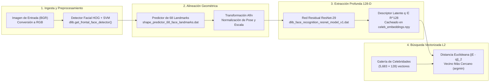
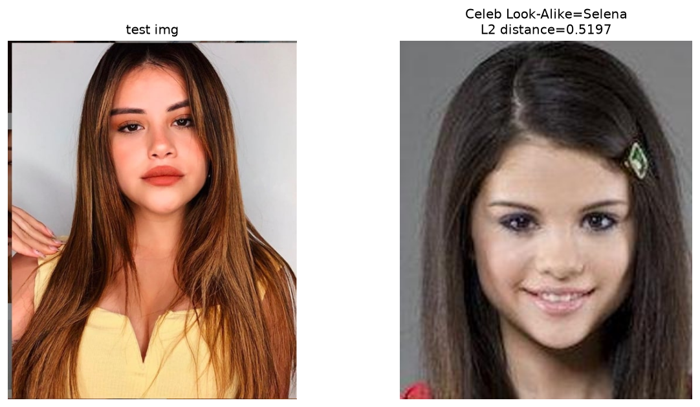
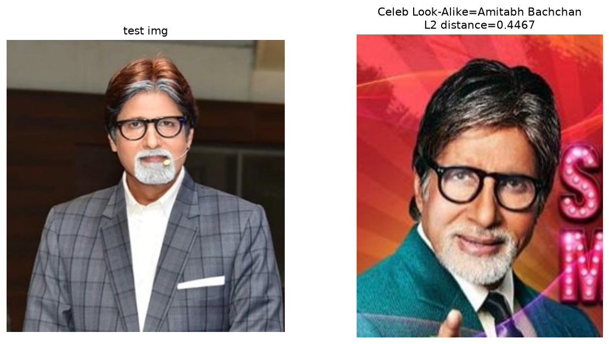

# DoppelGanger: Reconocimiento Facial y Búsqueda de Dobles Famosos en Espacio Latente 128-D

[](https://www.python.org/)
[](http://dlib.net/)
[](https://opencv.org/)
[](https://numpy.org/)
[](https://jupyter.org/)
[](LICENSE)

Sistema de **Visión por Computador y Aprendizaje Métrico Profundo (Deep Metric Learning)** que, a partir de la fotografía de una persona, localiza y alinea su rostro, lo proyecta a una variedad hiperesférica de **128 dimensiones** mediante una red residual **Dlib ResNet-29**, e identifica a su celebridad *look-alike* (doble más parecido) mediante búsqueda exacta vectorizada del vecino más cercano bajo norma Euclideana ($L_2$) sobre una galería de **$5,683$ rostros de celebridades**.

---

## Tabla de Contenidos

1. [Descripción General y Fundamento Matemático](#1-descripción-general-y-fundamento-matemático)
2. [Arquitectura del Sistema y Estructura del Repositorio](#2-arquitectura-del-sistema-y-estructura-del-repositorio)
3. [Guía Paso a Paso de Instalación y Ejecución](#3-guía-paso-a-paso-de-instalación-y-ejecución)
4. [Metodología Paso a Paso del Pipeline](#4-metodología-paso-a-paso-del-pipeline)
5. [Resultados Experimentales y Galería Visual](#5-resultados-experimentales-y-galería-visual)
6. [Guía para Inicializar y Subir a GitHub (Sin Push Automático)](#6-guía-para-inicializar-y-subir-a-github-sin-push-automático)
7. [Referencias y Licencia](#7-referencias-y-licencia)

---

## 1. Descripción General y Fundamento Matemático

### 1.1 Proyección al Espacio Métrico Facial ($\mathbb{R}^{128}$)

A diferencia de un clasificador cerrado con número fijo de clases (*Softmax*), un sistema de **reconocimiento facial abierto** aprende una función de encaje no lineal $f_\theta: \mathcal{I} \rightarrow \mathbb{R}^{128}$ entrenada con **pérdida de triplete (*Triplet Loss*)**. Dadas una imagen ancla $I_a$, una muestra positiva de la misma identidad $I_p$ y una muestra negativa de otra identidad $I_n$, la red optimiza sus pesos $\theta$ para satisfacer la condición de margen $\alpha$:

$$\|f_\theta(I_a) - f_\theta(I_p)\|_2^2 + \alpha < \|f_\theta(I_a) - f_\theta(I_n)\|_2^2$$

De este modo, rostros con morfología craneofacial similar se agrupan en vecindades cercanas dentro de $\mathbb{R}^{128}$.

### 1.2 Regla de Decisión del Vecino Más Cercano ($1\text{-NN}$ en Norma $L_2$)

Sea $\mathcal{G} = \{(\mathbf{e}_i, y_i)\}_{i=1}^{N}$ la galería de descriptores faciales precalculados de celebridades ($\mathbf{e}_i \in \mathbb{R}^{128}$, $N = 5,683$) y sea $\mathbf{q} = f_\theta(I_{\text{query}}) \in \mathbb{R}^{128}$ el vector de consulta de una persona de prueba. El doble famoso $\hat{y}$ se obtiene minimizando la distancia Euclideana ($L_2$):

$$i^* = \underset{i \in \{1, \dots, N\}}{\arg\min} \; \|\mathbf{e}_i - \mathbf{q}\|_2 = \underset{i \in \{1, \dots, N\}}{\arg\min} \sqrt{\sum_{k=1}^{128} \left(e_{i,k} - q_k\right)^2}, \qquad \hat{y} = y_{i^*}$$

---

## 2. Arquitectura del Sistema y Estructura del Repositorio

### 2.1 Diagrama de Flujo del Pipeline



### 2.2 Estructura de Archivos

```text
DoppelGanger_Find_Celebrity_Look_Alike/
├── DoppelGanger_Find_Celebrity_Look_Alike.ipynb   # Pipeline interactivo completo (Enrollment + Matching)
├── requirements.txt                               # Dependencias del entorno (numpy, opencv, dlib, matplotlib)
├── .gitignore                                     # Excluye datasets pesados, modelos .dat y cachés .npy
├── LICENSE                                        # Licencia MIT
├── README.md                                      # Documentación técnica paso a paso
└── assets/                                        # Visualizaciones de resultados generadas por el pipeline
    ├── output_sofia_selena.png                    # Caso de prueba 1: Sofia Solares → Selena Gomez
    └── output_shashikant_amitabh.png              # Caso de prueba 2: Shashikant Pedwal → Amitabh Bachchan
```

> [!NOTE]
> Al ejecutar el notebook por primera vez, se descargan y generan automáticamente en el directorio local (ignorados por `.gitignore`): `celeb_mini/`, `test-images/`, `celeb_mapping.npy`, `celeb_embeddings.npy`, `shape_predictor_68_face_landmarks.dat` y `dlib_face_recognition_resnet_model_v1.dat`.

---

## 3. Guía Paso a Paso de Instalación y Ejecución

### Paso 1: Ubicarse en el directorio del proyecto

```powershell
cd "g:\My Drive\repositorios de proyectos\DoppelGanger_Find_Celebrity_Look_Alike"
```

### Paso 2: Crear y activar un entorno virtual

```powershell
python -m venv .venv

# Windows (PowerShell)
.\.venv\Scripts\Activate.ps1

# Linux / macOS
source .venv/bin/activate
```

### Paso 3: Instalar las dependencias

```powershell
pip install -r requirements.txt
pip install jupyter ipykernel
```

> [!TIP]
> En **Windows**, `pip install dlib` compila desde código fuente C++ y requiere *Visual Studio Build Tools* + *CMake*. Si desea instalarlo directamente desde un binario precompilado sin compilador C++, ejecute `pip install dlib-bin`.

### Paso 4: Ejecutar el Notebook

```powershell
# Opción A: Ejecución interactiva en Jupyter Notebook
jupyter notebook DoppelGanger_Find_Celebrity_Look_Alike.ipynb

# Opción B: Ejecución completa por terminal (Headless)
jupyter nbconvert --to notebook --execute --inplace DoppelGanger_Find_Celebrity_Look_Alike.ipynb
```

---

## 4. Metodología Paso a Paso del Pipeline

1. **Detección de Rostro (HOG + Linear SVM):** `dlib.get_frontal_face_detector()` evalúa histogramas de gradientes orientados sobre una pirámide de escalas espaciales para localizar el cuadro delimitador (*bounding box*) del rostro frontal.
2. **Localización de Puntos Clave (68 Facial Landmarks):** `shape_predictor_68_face_landmarks.dat` estima la posición exacta de 68 puntos anatómicos (contorno mandibular, cejas, puente nasal, ojos y labios) para corregir rotación en el plano, traslación y escala.
3. **Extracción del Embedding 128-D (Enrollment con Caché en Disco):** `compute_face_descriptor()` proyecta cada rostro alineado de `celeb_mini/` ($5,830$ imágenes $\rightarrow$ **$5,683$ rostros válidos detectados**) a su vector de $128$ dimensiones y serializa la matriz resultante en `celeb_embeddings.npy` para cargas instantáneas en ejecuciones subsecuentes.
4. **Búsqueda Vectorizada en NumPy:** El cálculo de distancias entre el vector de consulta `query` $(128,)$ y la matriz de galería `gallery` $(5683, 128)$ se ejecuta en una sola operación matricial sin bucles en Python:
   ```python
   dists = np.linalg.norm(gallery - query[None, :], axis=1)
   idx = int(np.argmin(dists))
   ```

---

## 5. Resultados Experimentales y Galería Visual

| Imagen de Consulta | Identidad Real (Prueba) | Doble Famoso Detectado (*Look-Alike*) | Distancia Euclideana ($L_2$) | Umbral de Referencia Dlib |
| :--- | :--- | :--- | :---: | :---: |
| `test-images/sofia-solares.jpg` | **Sofia Solares** | **Selena Gomez** | **`0.5197`** | `< 0.60` (Alta similitud biométrica) |
| `test-images/shashikant-pedwal.jpg` | **Shashikant Pedwal** | **Amitabh Bachchan** | **`0.4467`** | `< 0.60` (Alta similitud biométrica) |

### Caso 1: Sofia Solares $\rightarrow$ Selena Gomez ($d_{L_2} = 0.5197$)



---

### Caso 2: Shashikant Pedwal $\rightarrow$ Amitabh Bachchan ($d_{L_2} = 0.4467$)



---

---

## 6. Referencias y Licencia

- King, D. E. (2009). *Dlib-ml: A Machine Learning Toolkit*. Journal of Machine Learning Research (JMLR), 10, 1755–1758.
- Modelos preentrenados: [davisking/dlib-models](https://github.com/davisking/dlib-models).
- Distribuido bajo la licencia **MIT**. Consulte el archivo [`LICENSE`](LICENSE) para más detalles.
